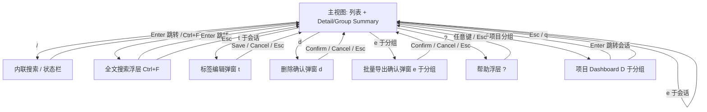

# 07. 界面流转图与快捷键总表

## 1. 界面状态流转（Mermaid）



**设计约束**：任意时刻只允许一个浮层/弹窗处于打开状态（沿用现有 `delete_modal_state` / `show_help_modal` 互斥模式），新增的 `TagModal`、`SearchFull`、`ExportConfirm`、`Dashboard` 都遵循同一互斥规则，不叠加弹窗。

## 2. 快捷键总表（现状 + 新增）

| 按键 | 功能 | 状态 |
| :-- | :-- | :-- |
| `Tab` / `Shift+Tab` | 切换引擎 | 已有 |
| `j`/`k`/方向键 | 上下导航 | 已有 |
| `Enter` | 展开/恢复会话 | 已有 |
| `/` | 列表内搜索（元数据，支持 `fav:`/`tag:` 扩展语法） | 已有 + 语法扩展 |
| `n` / `N` | 下一个/上一个匹配 | 已有 |
| `Ctrl+N` | 新建会话 | 已有 |
| `Space` | 展开/折叠分组 | 已有 |
| `d` / `Delete` | 删除会话/分组 | 已有 |
| `g` | 切换分组模式（新增 By Tag 档位） | 已有 + 扩展 |
| `Ctrl+Alt+H/V` | 切换横/纵分栏 | 已有 |
| `Ctrl+Alt+方向键` | 切换焦点面板 | 已有 |
| `Ctrl+Alt+[-/=/+]` | 调整面板比例 | 已有 |
| `?` | 帮助浮层 | 已有（内容需同步新增快捷键） |
| `q` / `Esc` | 退出 / 返回上一层 | 已有 |
| `f` | 切换收藏状态 | **新增** |
| `t` | 编辑标签 | **新增** |
| `e` | 导出 Markdown（会话/分组） | **新增** |
| `Ctrl+F` | 全文搜索浮层 | **新增** |
| `D`（大写） | 打开项目 Dashboard | **新增** |

## 3. 冲突检查

* 新增键位 `f` `t` `e` 均为当前未占用的小写字母（现状表中已用的小写字母仅 `j k n g d q`）。
* `D`（大写）与已有 `d`（小写，删除）在多数终端下是可区分的独立按键事件，不冲突；实现时需注意 Shift+d 的按键事件解析（参考现有 `Ctrl+Alt` 组合键在 Windows Terminal 下的兼容处理经验，见 README）。
* `Ctrl+F` 与已有 `Ctrl+N`、`Ctrl+Alt+*` 均不冲突。

## 4. Help 弹窗内容同步更新

新增功能上线后，`?` 帮助浮层需要补充以下条目（沿用现有排版风格，弹窗高度需要相应增加 4-5 行）：

```text
  f                  Toggle favorite
  t                  Edit tags
  e                  Export to Markdown
  Ctrl+F             Full-text search
  D                  Project dashboard (on group header)
```
