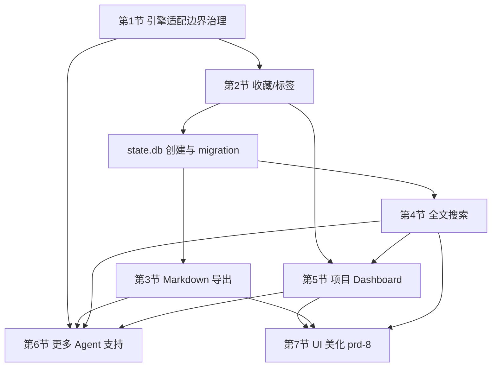

# 补充需求文档 (PRD-7) - 效率增强：标签、导出、全文搜索与项目 Dashboard

本文档承接 `prd.md` ~ `prd-6.md` 已交付的浏览 / 恢复 / 分组 / 多引擎能力，规划下一阶段的效率增强功能。

**文档状态**：可交付——所有阻塞性决策已敲定，开放问题已标注不阻塞或设置了明确的决策门。

---

## 0. 范围与决策记录

### 0.1 本阶段功能清单（按实施顺序）

| 顺序 | 功能 | 类型 | 影响的 System Spec 域 |
| :-- | :-- | :-- | :-- |
| 0 | 引擎适配边界治理 | 工程重构 + 护栏 | 修改 `session-catalog`（`SessionEngine` 集中化）、修改 `tui-interaction`（消费通用接口） |
| 1 | 收藏 / 标签 | 新功能 | 新增 `persisted-state`；修改 `session-catalog`、`tui-interaction` |
| 2 | Markdown 导出 | 新功能 | 新增 `session-export`；修改 `tui-interaction` |
| 3 | 全文搜索 | 新功能 | 修改 `persisted-state`；新增 `content-search`；修改 `tui-interaction` |
| 4 | 项目 Dashboard | 新功能 | 修改 `tui-interaction` |
| 5 | 更多 Agent 支持 | 新增引擎适配（示例/验证） | 修改 `session-catalog`、`session-detail`、`session-launch`、`session-deletion` |
| 6 | UI 美化 | 另出 `prd-8.md`，本文档只列收尾清单 | 待定 |

### 0.2 已取消的功能（记录原因，避免后续误解为遗漏）

* **Git 关联**：已取消。原因：需求定义模糊（关联 branch？关联 commit 时间窗？），且与核心"回顾对话历史"场景耦合度不高，收益不确定，暂不投入。
* **Session Diff**：已取消。原因：通用会话间文本 diff 的语义对齐成本高、价值有限；即便收窄为"父子分支对比"仍属于探索性功能，本阶段优先做确定性更高的效率工具。

### 0.3 相对于初版讨论顺序的调整

* **Markdown 导出提前**：零依赖、可直接复用 `detail.rs` 已经产出的 `SessionDetail.transcript_blocks`，成本低、见效快，不应排在 Dashboard 之后。
* **"更多 Agent 支持"的工程底座（第 0 节）提前到全文搜索之前**：全文搜索、标签、Dashboard 都会新增跨引擎的数据处理逻辑，必须先钉死"引擎相关代码只能出现在哪些文件里"的规则，否则后续每新增一个引擎都要在 3-4 个新功能模块里重新分支一次。

### 0.4 设计影响声明

* 档位：`visual`
* 影响面：标签编辑弹窗、全文搜索浮层、Dashboard 面板、导出状态栏提示、收藏图标与标签徽标。
* 视觉规范不在本 PRD 展开，由 `prd-8.md` 统一覆盖。本 PRD 只定义功能行为与交互触发方式。

### 0.5 决策记录

| # | 决策 | 理由 |
| :-- | :-- | :-- |
| D1 | 用户状态存储在 `~/.session-manager/state.db`（SQLite），与引擎数据目录完全隔离 | 维持工具对引擎原始数据的只读承诺 |
| D2 | 身份键为 `(engine, session_id)` 而非文件路径 | session_id 是各模块已使用的稳定标识，路径可因文件整理变化 |
| D3 | 不新增 `EngineAdapter` trait 体系 | 现有 match 分发 + 归一化输出结构已足够，四文件白名单 + 编译器穷尽检查提供等价治理 |
| D4 | 全文搜索用 SQLite FTS5，不引入外部搜索引擎 | 复用已有 `rusqlite` 依赖，零新增二进制依赖 |
| D5 | `Ctrl+F`（全文搜索）与 `/`（元数据过滤）并行共存，不合并 | 语义不同、数据源不同、交互模式不同，合并会增加用户困惑 |
| D6 | 导出覆盖已有同名文件，不做版本管理 | 导出是确定性生成，内容可重复产出 |
| D7 | 后台索引不阻塞 TUI 主循环 | 大规模会话首次索引可能耗时数十秒，阻塞不可接受 |
| D8 | 标签过滤复用现有 `/` 搜索框加前缀语法，不新增独立过滤 UI | 减少界面元素，保持一致的搜索入口 |
| D9 | 标签编辑弹窗复用 `DeleteModalState` 的弹窗交互模式 | 是否需要新的通用 Modal 抽象在实施时决定（见 10.3），不阻塞需求定义 |
| D10 | `SessionEngine` 集中提供 `default_engine()` / `tab_order()` / `supports_*()` | 消除 `app.rs`/`tui.rs` 对具体变体的硬编码，使新增引擎只改适配层（见第 1 节） |

### 0.6 `design/` 目录定位

`design/` 目录下的 TUI 界面设计稿（`01-baseline-current-ui.md` ~ `07-navigation-flow-keymap.md`）是**配套参考材料**，不是 SpecFlow 规范性文档。具体边界：

* 设计稿中"待确认问题"里的建议默认值（如标签统一配色、浮层比例基线、导出无需确认弹窗等）已在本 PRD 对应章节的 AC 或决策记录中体现的，以本 PRD 为准。
* 设计稿中未被本 PRD 明确采纳或否决的建议，Planner 可自行采纳或提出替代方案，不视为约束。
* Planner 产出的 `design.md` / `ux-design.md` 是 SpecFlow Change 内的规范性设计文档，与 `design/` 参考稿是独立的——前者是交付物，后者是输入素材。

---

## 1. 前提：引擎适配边界治理

### 1.1 目标

1. 将引擎列表、默认引擎、Tab 顺序、能力查询等**引擎枚举知识**集中到 `SessionEngine` 自身的方法上，使 `app.rs`、`tui.rs`、`shortcut_probe.rs` 等业务/UI 消费层不再硬编码具体引擎变体。
2. 防止第 2-5 节新增模块在实现时引入按引擎分支的业务逻辑。
3. 确保新增引擎时改动范围可控且编译器可检测。

> **定位**：本节同时包含一次实际的代码重构（消除现有泄漏）和面向后续 Change 的 reviewer 约束。重构部分会产出 `session-catalog`（`SessionEngine` 集中化）和 `tui-interaction`（消费通用接口）的 Delta Spec。

### 1.2 现状确认（基于当前代码）

项目已经存在一层归一化基础，不需要推倒重来：

* `catalog.rs`：`EngineCatalogReader::load_sessions_for` 按 `SessionEngine` match 分发，产出统一的 `SessionListItem`。`SessionEngine` 已提供 `label()`、`root_dir()` 等描述性方法。
* `detail.rs`：`load_detail_for_engine` 按引擎分发解析，输出已是统一结构 `SessionDetail { session_meta, transcript_blocks: Vec<TranscriptBlock> }`。
* `resume.rs`：trait + 依赖注入模式（`ResumeSessionExecutor`），是抽象程度最高的。
* `delete.rs`：按 `SessionEngine` 做最简单的 match 分发。

**但存在以下泄漏点**，业务/UI 层直接引用了具体引擎变体：

| 文件 | 泄漏内容 | 出现位置 |
| :-- | :-- | :-- |
| `app.rs`（非 test） | 硬编码 `SessionEngine::Pi` 作为默认引擎（4 处） | 初始化 `active_engine` 和 `engine_status_messages` |
| `tui.rs`（非 test） | 硬编码 `[Pi, OpenCode, Codex, Claude]` 数组渲染 Tab 栏（1 处） | `render_header_line` |
| `shortcut_probe.rs` | `match` 具体引擎生成 probe 数据（2 处） | `probe_item_for` |

测试代码中对具体变体的引用不受此规则约束——测试需要验证具体引擎的行为。

### 1.3 重构要求

在 `SessionEngine` 上新增以下集中式方法（或常量），使消费层通过通用接口获取引擎元信息，而非硬编码变体列表：

* `SessionEngine::default_engine() -> Self` — 返回默认活动引擎（当前为 Pi）。
* `SessionEngine::tab_order() -> &'static [Self]` — 返回 Tab 栏显示顺序。
* `SessionEngine::supports_resume(self) -> bool` — 能力查询示例（为 R4 建立模式）。
* 后续按需新增其他能力查询方法（如 `supports_cli_delete`）。

重构后：
* `app.rs` 初始化改为 `SessionEngine::default_engine()`，不再直接写 `SessionEngine::Pi`。
* `tui.rs` 的 Tab 渲染改为遍历 `SessionEngine::tab_order()`，不再硬编码数组。
* `shortcut_probe.rs` 改为遍历 `tab_order()` 或使用 `default_engine()`，消除具体变体 match。

### 1.4 治理规则

重构完成后，以下规则作为后续所有 Change 的 reviewer 约束持续生效：

* **R1（适配层白名单）**：`catalog.rs`、`detail.rs`、`resume.rs`、`delete.rs` 是仅允许出现 `match engine` / `SessionEngine::Xxx` 分支判断的四个文件（`SessionEngine` 自身的 `impl` 方法天然位于 `catalog.rs`，不受此条限制）。
* **R2（消费归一化数据）**：本阶段新增模块（及已有的 `app.rs` / `tui.rs`）只能消费 `SessionListItem` / `SessionDetail` / `TranscriptBlock` / `DetailViewport` 等引擎无关的数据结构，以及 `SessionEngine` 上的通用查询方法（`label()`、`tab_order()`、`default_engine()`、`supports_*()` 等），禁止对 `SessionEngine` 做业务分支。
* **R3（编译器兜底）**：新增引擎时只需在 `SessionEngine` 枚举里加一个变体，Rust 的 match 穷尽性检查会在 R1 列出的四个文件和 `SessionEngine` 的 `impl` 方法里逐一报错，天然生成"需要改动的清单"。`app.rs`、`tui.rs` 等消费层不会因新变体而产生编译错误。
* **R4（能力差异走查询接口）**：若某引擎有能力缺失（如不支持 resume），通过 `SessionEngine` 的能力查询方法返回值降级处理，不允许在业务层写 `if engine == SessionEngine::Xxx`。

### 1.5 验收标准

* **AC1（重构验证）**：`app.rs`（非 test）、`tui.rs`（非 test）、`shortcut_probe.rs` 中不再出现 `SessionEngine::Pi`、`SessionEngine::OpenCode`、`SessionEngine::Codex`、`SessionEngine::Claude` 等具体变体引用。改为使用 `default_engine()` / `tab_order()` 等通用方法。
* **AC2（白名单验证）**：在测试代码中新增一个 mock 的 `SessionEngine` 变体后，编译错误只出现在 `catalog.rs`（含 `SessionEngine` impl）/ `detail.rs` / `resume.rs` / `delete.rs` 四个文件内；`app.rs`、`tui.rs`、新增模块（`tags.rs` / `search.rs` / `export.rs` / `dashboard.rs`）无需修改即可通过编译。
* **AC3（行为不变）**：重构不改变任何用户可见行为——默认引擎、Tab 顺序、所有已通过的 focused tests 和 `cargo test` 全部保持通过。
* **AC4（Review checklist）**：Code Review checklist 增加一条："本次 diff 是否在白名单外的文件引入了 `SessionEngine` 具体变体分支判断（测试代码除外）"。

---

## 2. 收藏 / 标签

### 2.1 用户故事

作为长期使用者，我希望能标记重要会话（收藏）、给会话打自定义标签（如 `bug`、`需求梳理`、`重构`），以便日后按标签快速筛选，而不是依赖记忆去翻找。

### 2.2 数据存储方案

新增本工具**自有**的本地状态库，与只读的引擎数据严格分离：

* 路径：`~/.session-manager/state.db`（SQLite，复用已有依赖 `rusqlite`）。
* 表结构：

```sql
CREATE TABLE session_meta (
    engine       TEXT    NOT NULL,   -- SessionEngine::label()
    session_id   TEXT    NOT NULL,
    is_favorite  INTEGER NOT NULL DEFAULT 0,
    tags         TEXT    NOT NULL DEFAULT '',  -- JSON 数组字符串，如 ["bug","refactor"]
    updated_at   INTEGER NOT NULL,
    PRIMARY KEY (engine, session_id)
);
```

* **身份键选择**：使用 `(engine, session_id)` 而非文件绝对路径（决策 D2）。
* **schema 演进**：`state.db` 中维护一个 `pragma user_version`，每次启动时检查并执行增量 migration（第 4 节 FTS 表也会通过同一 migration 链新增）。migration 失败 MUST 记录日志并回退到"无持久化状态"模式（等同于 state.db 不存在），不 panic。

### 2.3 加载与合并

* App 启动 / 手动刷新扫描完 `session_list` 后，一次性读取 `state.db` 全表到内存 `HashMap<(SessionEngine, String), SessionUserMeta>`，合并进每个 `SessionListItem`：新增 `is_favorite: bool`、`tags: Vec<String>` 字段。
* 写入是即时同步（收藏/改标签后立刻写 `state.db`），不做延迟批量写入，避免异常退出丢数据。
* 若 `state.db` 中存在引擎目录已不存在的 session 记录（orphan），保持不动，不主动清理——避免因为用户临时移动文件夹而丢失标签数据。

### 2.4 交互设计

* **快捷键**：
  * `f`：切换当前选中会话的收藏状态（列表焦点或详情焦点均可触发）。
  * `t`：打开标签编辑弹窗，复用 `DeleteModalState` 的弹窗交互模式（输入框 + 提交/取消焦点切换），输入逗号分隔标签，`Enter` 提交、`Esc` 取消。
* **列表视觉**：
  * 收藏会话在摘要前追加 `★`。
  * 有标签的会话在摘要后追加灰色小字 `#tag1 #tag2`（超宽时截断，遵循 prd-5 的截断规范）。
* **过滤复用现有搜索框**（决策 D8）：在现有 `/` 输入解析里增加两个前缀语法：
  * `fav:` — 只显示收藏的会话。
  * `tag:关键字` — 只显示包含该标签（子串匹配）的会话。
  * 二者可与普通关键字组合，如 `tag:bug 登录`。
  * 无效前缀（如 `tag:` 后无内容）视为普通文本搜索，不报错。
* **分组模式扩展**：复用 prd-5 定义的 `g` 循环切换分组模式，新增第三种：`By Time → By Project → By Tag → (循环)`。无标签的会话归入 `未分类` 分组。多标签的会话在每个匹配的标签分组中各出现一次。

### 2.5 验收标准

* **AC1**：Given 选中任意会话，When 按 `f`，Then 列表中该会话立即显示/取消 `★`，且重启程序后状态保持（读自 `state.db`）。
* **AC2**：Given 某会话打了标签 `bug`，When 在搜索框输入 `tag:bug`，Then 列表只保留包含该标签的会话，实时更新匹配数（复用现有 `live_search_matches` 机制）。
* **AC3**：Given `state.db` 不存在，When 程序启动，Then 自动创建文件与表结构，所有会话视为无收藏无标签，主流程正常运行。
* **AC4**：Given `state.db` 存在但文件损坏（非法 SQLite 格式），When 程序启动，Then 记录警告日志，回退到"无持久化状态"模式（标签/收藏操作在当前会话内存中生效但不持久化），不 panic，不影响会话浏览主流程。
* **AC5**：Given `~/.session-manager/` 目录不存在，When 首次触发收藏操作，Then 自动创建目录和 `state.db`。
* **AC6**：Given `state.db` 所在目录无写权限，When 按 `f` 或 `t` 提交，Then 状态栏显示"无法保存：权限不足"错误提示，内存状态不变，不 panic。
* **AC7**：标签编辑弹窗遵循 R2 规则，不引入按引擎的分支逻辑。
* **AC8**：Given 标签编辑弹窗已打开，When 按 `Esc`，Then 弹窗关闭，标签无变化，焦点恢复到弹窗前位置。
* **AC9**：Given 用户输入包含空标签（如 `bug,,refactor` 或尾部逗号），When 提交，Then 空值被静默过滤，只保存有效标签。

---

## 3. Markdown 导出

### 3.1 用户故事

作为使用者，我希望把某次对话导出为一份干净的 Markdown 文件，方便分享给同事、存档到笔记软件或粘贴进文档。

### 3.2 触发方式

* **单会话导出**：选中某个 session 叶子节点，按 `e`。
* **分组批量导出**：光标停在 Group Header（项目/时间/标签分组）时按 `e`，导出该分组下所有会话。

### 3.3 内容与映射规则

直接复用 `detail.rs` 的 `load_detail_for_engine` 输出（不重新解析 JSONL/SQLite），按 `TranscriptBlock` 类型映射：

| `TranscriptBlock` | Markdown 输出 |
| :-- | :-- |
| `UserText` | `### 🧑 User\n\n{text}\n` |
| `AssistantMarkdown` | `### 🤖 Assistant\n\n{text}\n`（原样保留，已是 Markdown） |
| `ToolCallSummary` / `ToolOutputSummary` | 按当前 `DisplayConfig.visible_blocks` 口径决定是否包含，默认与右侧详情面板当前显示的内容一致 |
| `Thinking` / `SystemContextFolded` / `CorruptedLineNotice` | 默认不导出（可通过导出弹窗勾选"包含完整上下文"覆盖） |

文件头部附加 YAML frontmatter：

```yaml
---
session_id: <session_id>
engine: <Codex|Claude|Pi|OpenCode>
cwd: <项目路径>
started_at: <会话开始时间>
exported_at: <导出时间>
favorite: <true|false>
tags: [bug, refactor]
---
```

### 3.4 导出路径与配置

* 默认导出目录：`~/.session-manager/exports/{engine}/{session_id}.md`。
* 分组批量导出：`~/.session-manager/exports/{engine}/{group_label}/`，并生成一份 `index.md` 汇总本次导出的文件列表。
* 支持在 `config.toml` 追加：

```toml
[export]
output_dir = "~/my-notes/ai-sessions"
```

* 导出完成后状态栏提示绝对路径；若目标文件已存在，直接覆盖（决策 D6）。

### 3.5 验收标准

* **AC1**：Given 选中一个会话，When 按 `e`，Then 在配置的导出目录下生成对应 `.md` 文件，内容与右侧详情面板当前可见内容口径一致。
* **AC2**：Given 光标停在 Group Header，When 按 `e`，Then 该分组下所有会话被逐一导出，并生成 `index.md`。
* **AC3**：Given 会话内容包含损坏行（`CorruptedLineNotice`），When 默认导出，Then 该行被跳过，不中断导出流程；When 勾选"包含完整上下文"导出，Then 损坏行以 blockquote 注明 `> [corrupted line]` 形式包含。
* **AC4**：导出逻辑只依赖 `SessionDetail` / `TranscriptBlock`，不直接读取引擎原始文件/数据库，遵循 R2。
* **AC5**：Given 导出目录不存在，When 触发导出，Then 自动递归创建目录并完成导出。
* **AC6**：Given 导出目录无写权限或磁盘空间不足，When 触发导出，Then 状态栏显示具体错误信息（含路径），不 panic，不丢失已完成的部分导出文件。
* **AC7**：Given 分组批量导出中某个会话的 detail 加载失败（如源文件被删除），When 继续导出，Then 该会话被跳过并在 `index.md` 中标注失败原因，其余会话正常导出。
* **AC8**：Given `session_id` 包含文件系统非法字符（如 `/`、`\0`），When 生成文件名，Then 非法字符被替换为 `_`，不产生路径穿越。

---

## 4. 全文搜索

### 4.1 现状 vs 目标

* **现状**：`/` 搜索（`SearchState` / `searchable_text`）只匹配 `SessionListItem` 的元数据字段，不涉及会话正文内容，且只在当前已加载的列表内过滤。
* **目标**：支持跨全部已扫描会话、跨引擎的正文关键字检索，返回命中会话列表 + 命中片段（snippet），并可直接跳转到命中的具体消息位置。

这是本阶段工程量最大的功能。与现有元数据搜索（`/`）是两套并行能力（决策 D5），不合并、不互相影响现有行为。

### 4.2 技术方案

* **索引存储**：复用第 2 节新建的 `~/.session-manager/state.db`，新增 FTS5 虚拟表（决策 D4）：

```sql
CREATE VIRTUAL TABLE session_content_fts USING fts5(
    engine,
    session_id,
    block_index,
    role,
    content,
    tokenize = 'unicode61'
);

-- 索引元数据：追踪每个会话的索引状态
CREATE TABLE IF NOT EXISTS index_meta (
    engine       TEXT    NOT NULL,
    session_id   TEXT    NOT NULL,
    indexed_mtime INTEGER NOT NULL,
    indexed_size  INTEGER NOT NULL,
    PRIMARY KEY (engine, session_id)
);
```

* **Cargo 依赖调整**：`rusqlite` 需要额外启用 `fts5` feature：

```toml
rusqlite = { version = "0.32", features = ["bundled", "fts5"] }
```

* **索引构建时机与增量策略**：
  1. 每次 catalog 扫描（启动 / 手动刷新）得到 `SessionListItem` 列表后，比较每个会话源文件的 `mtime`/大小与 `index_meta` 表中记录值；发生变化才重新提取。
  2. 提取内容 = 调用 `detail.rs` 的 `load_detail_for_engine`，取 `transcript_blocks` 中 `UserText` / `AssistantMarkdown` / `ToolCallSummary` / `ToolOutputSummary` 四类文本写入 FTS 表（先按 `(engine, session_id)` 删除旧记录再插入，保证幂等）。
  3. 索引构建在后台线程执行（决策 D7），不阻塞 TUI 主循环；未完成时状态栏显示 `索引中 N/M`，允许用户照常浏览/搜索已完成部分。
  4. `Thinking` / `SystemContextFolded` / `CorruptedLineNotice` 默认不索引。
  5. 单个会话的索引提取失败（如文件被删、解析异常）不中断批量索引流程，跳过并记录日志。

### 4.3 交互设计

* 新增全局快捷键 `Ctrl+F`（跨会话全文搜索），与现有 `/`（当前列表元数据过滤）明确区分。
* 触发后弹出搜索输入浮层，输入时下方实时展示跨会话匹配结果（项目名 / 时间 / 命中片段高亮），方向键选择结果。
* `Enter` 跳转：切换到命中会话所在的 engine tab，选中该会话，并将详情视图定位到命中的具体 `transcript_block` 位置。
* `Esc` 关闭搜索浮层，焦点恢复到浮层打开前的位置。
* 索引未就绪时提示"索引构建中 (N/M)，搜索范围限于已完成部分"。
* 结果为空时提示"未找到匹配内容"，不留白屏。

### 4.4 验收标准

* **AC1**：Given 某会话正文中出现关键字（但摘要/文件名中没有），When 按 `Ctrl+F` 搜索该关键字，Then 该会话出现在结果列表中并显示命中片段。
* **AC2**：Given 一个大会话文件正在被索引，When 用户在索引未完成前发起搜索，Then 已完成部分正常可搜，状态栏明确提示索引进度，不阻塞 UI 操作。
* **AC3**：Given 用户跳转到某条搜索结果，When 按 `Enter`，Then 详情面板正确切换 engine/session 并将视口滚动到命中内容附近。
* **AC4**：索引提取逻辑复用 `detail.rs` 现有解析函数，不新增按引擎分支的文本提取代码，遵循 R1/R2。
* **AC5**：Given 用户删除 `state.db`，When 程序重启，Then 索引从零重建，不影响任何引擎自身的会话数据（只读性保证）。
* **AC6**：Given 一个会话的源文件在索引完成后被删除，When 用户搜索命中该会话的旧索引条目并跳转，Then 详情加载失败时显示"会话已不存在"提示，不 panic。
* **AC7**：Given 后台索引线程正在运行，When 用户切换 engine tab 或刷新 catalog，Then 索引线程安全中断当前批次，基于新 catalog 结果重新启动增量索引。
* **AC8**：Given `config.toml` 中设置 `[search] enabled = false`，When 程序启动，Then 不启动后台索引线程，`Ctrl+F` 提示"全文搜索已禁用"，其他功能正常运行。
* **AC9**：Given 搜索浮层已打开，When 按 `Esc`，Then 浮层关闭，焦点恢复到浮层打开前的位置，不影响主列表状态。

---

## 5. 项目 Dashboard

### 5.1 定位

复用现有 `RightPanelMode` 枚举（当前含 `SessionDetail` / `GroupSummary`），新增 `RightPanelMode::ProjectDashboard`，作为"按项目分组"场景下的加强版统计视图。

### 5.2 触发方式

* 在"按项目分组"模式下，光标停在某个项目 Group Header 时按 `D`（大写），进入该项目的 Dashboard 详情视图。
* `Esc` / `q` 退出，返回原有的 `GroupSummary` 卡片视图。
* 在非"按项目分组"模式下按 `D`，无响应（不切换分组模式，不弹错误）。

### 5.3 展示指标（MVP 范围）

* 项目路径（`cwd_group_label`）。
* 总会话数，按引擎细分（如 `Codex: 12, Claude: 3`）。
* 收藏数（依赖第 2 节数据）。
* 标签分布 Top 5（依赖第 2 节数据）。
* 最近一次活跃时间。
* 若全文搜索索引已就绪（第 4 节）：该项目下的总消息数 / 估算总字数；索引未就绪时显示 `--`，不报错、不阻塞。

**明确不包含**：Git 提交信息（已取消需求）、时间趋势折线图等复杂可视化。

### 5.4 交互

* Dashboard 内以列表形式展示"该项目下最近 N 条会话"（N 由面板可用高度动态计算），方向键选择、`Enter` 跳转到对应会话详情（复用现有 `begin_detail_request` 逻辑）。

### 5.5 验收标准

* **AC1**：Given 光标停在某项目 Group Header 且当前为"按项目分组"模式，When 按 `D`，Then 右侧面板切换为该项目的 Dashboard，展示 5.3 定义的指标。
* **AC2**：Given 全文搜索索引尚未就绪，When 打开 Dashboard，Then "总消息数/总字数"字段显示 `--` 占位符而非报错或空白面板。
* **AC3**：Given Dashboard 内选中某条最近会话并按 `Enter`，Then 正确跳转到该会话的详情视图。
* **AC4**：Dashboard 的数据聚合逻辑只读取 `SessionListItem` 及第 2/4 节产出的用户数据，不新增按引擎分支代码，遵循 R2。
* **AC5**：Given 某项目分组下会话数为 0（所有会话已被删除但分组标签仍存在），When 打开 Dashboard，Then 各计数显示为 0，最近会话列表为空，面板不崩溃。
* **AC6**：Given 当前为"按时间分组"或"按标签分组"模式，When 按 `D`，Then 无任何响应，不改变当前面板内容。

---

## 6. 更多 Agent 支持

### 6.1 定位

本阶段不批量新增引擎，而是把第 1 节的治理规则作为**前提**，用一次真实的新引擎接入作为验收出口。

### 6.2 候选清单（待确认优先级后再排期）

常见候选：Gemini CLI、Cursor CLI Agent、Aider、Cline / Roo Code、Amp、Continue 等。每个候选需要先确认：

* 会话数据落盘位置与格式（JSONL？SQLite？其它）。
* 是否有父子会话/子代理概念。
* 是否有对应的 CLI resume 命令可供拉起。

> 这些信息需要后续单独调研，本文档不假设具体格式。本节是治理规则的验收出口，不是本阶段的强制交付项——第 2-5 节全部交付后，第 6 节方可排期。

### 6.3 验收标准

* **AC1**：新增一个引擎，改动只发生在 `SessionEngine` 枚举 + 第 1.2 节列出的四个适配层文件（`catalog.rs` / `detail.rs` / `resume.rs` / `delete.rs`）。
* **AC2**：标签、导出、全文搜索、Dashboard 四个功能对新引擎自动生效，无需修改新增模块代码。
* **AC3**：若新引擎存在能力缺失（如不支持 resume），通过 `SessionEngine` 新增的能力查询方法降级处理，UI 给出明确提示（如按钮置灰或提示文案），不 panic。

---

## 7. UI 美化（收尾，另出 `prd-8.md`）

本阶段不展开具体视觉规范，待第 2-6 节功能落地、新增界面元素稳定后统一稽核，方法论沿用 `prd-6.md`。已知需要在 `prd-8.md` 中覆盖的新增界面：

* 全文搜索浮层（`Ctrl+F`）。
* 标签编辑弹窗（`t`）。
* 收藏图标 / 标签徽标的配色与对齐。
* Dashboard 卡片布局。
* 导出成功/失败的状态栏提示样式。

---

## 8. 非目标（本阶段明确不做）

* Git 分支/commit 关联 —— 已取消。
* Session Diff / 分支对比 —— 已取消。
* 标签/收藏数据的云同步或多设备共享。
* 全文搜索的语义/向量检索（仅做关键字 FTS，不引入 embedding/模型依赖）。
* Dashboard 内的图表可视化（折线图/柱状图等）。
* `state.db` 的 orphan 记录自动清理（保守策略，避免误删用户标签数据）。
* 导出格式扩展（HTML、PDF 等）—— 本阶段只做 Markdown。

---

## 9. 里程碑依赖图



> 注：第 5 节与第 6 节的依赖关系调整——更多 Agent 支持依赖所有功能模块已交付，因为其验收标准要求新引擎在 标签/导出/搜索/Dashboard 上自动生效。

---

## 10. 风险与开放问题

### 已识别风险

| # | 风险 | 缓解措施 |
| :-- | :-- | :-- |
| R1 | `state.db` 与引擎自身数据隔离 | 所有写操作只发生在 `~/.session-manager/state.db`，引擎数据目录保持只读 |
| R2 | 首次建索引的性能与磁盘占用 | 后台线程 + 进度提示 + `config.toml` 的 `[search] enabled` 开关 |
| R3 | `state.db` 文件损坏 | 启动时校验，损坏时降级为无持久化模式，不阻塞主流程 |
| R4 | 导出路径穿越 | session_id 中非法字符替换为 `_` |
| R5 | 后台索引与 UI 线程数据竞争 | 索引线程通过 channel 将结果发送到主循环，不直接共享可变状态 |
| R6 | 引擎适配泄漏 | 第 1 节重构消除现有泄漏，R1-R4 规则 + AC4 Review checklist 防止回归 |

### 开放问题（不阻塞实施）

| # | 问题 | 决策门 |
| :-- | :-- | :-- |
| O1 | 标签编辑弹窗是否需要抽象出通用 Modal 结构 | 实施第 2 节时看 `app.rs` 现有 Modal 代码再决定，Planner 可酌情设计 |
| O2 | 全文搜索结果跳转到具体消息位置的 viewport API 形态 | 实施第 4 节时详细设计，本文档只定义需求（"定位到命中 block 附近"），不锁定实现签名 |
| O3 | 更多 Agent 支持的具体目标引擎 | 需要单独调研候选引擎的会话存储格式后再排期，第 6 节不是本阶段的强制交付项 |
| O4 | 大规模会话（数千文件/GB 级）的索引耗时上限 | 实施第 4 节时实测，若超过 60 秒需考虑分批策略，本文档不预设具体数字 |
| O5 | `design/` 各文件"待确认问题"中未被本 PRD 明确采纳的建议 | Planner 在 Change planning 阶段自行决策，不阻塞 PRD 交付（见 0.6） |

---

## 11. SpecFlow 转换指引

本 PRD 的 SpecFlow 转换建议如下，Planner 据此创建 Change：

### 建议拆分为 2-3 个 Change

| Change | 包含的 PRD 节 | 理由 |
| :-- | :-- | :-- |
| `efficiency-state-and-tags` | 第 1 节 + 第 2 节 | 第 1 节重构消除现有泄漏并建立治理规则；第 2 节建立 state.db 基础设施 |
| `efficiency-export-search-dashboard` | 第 3 节 + 第 4 节 + 第 5 节 | 共享 state.db，有依赖关系但可在一个 Change 内通过 spec 依赖排序 |
| `new-engine-validation`（可选） | 第 6 节 | 依赖前两个 Change 全部交付，且需要先完成引擎调研 |

### 预期的 Delta Spec 域映射

| 功能 | 新增域 | 修改域 |
| :-- | :-- | :-- |
| 引擎适配治理 | — | `session-catalog`（`SessionEngine` 新增 `default_engine()` / `tab_order()` / `supports_*()` 集中方法）、`tui-interaction`（Tab 渲染改为消费 `tab_order()`） |
| 收藏/标签 | `persisted-state`（state.db 生命周期、schema、migration、降级行为） | `session-catalog`（SessionListItem 扩展字段）、`tui-interaction`（`f`/`t` 快捷键、`tag:` / `fav:` 过滤、By Tag 分组） |
| Markdown 导出 | `session-export`（导出触发、内容映射、路径生成、批量导出、错误处理） | `tui-interaction`（`e` 快捷键、状态栏提示） |
| 全文搜索 | `content-search`（FTS5 索引生命周期、增量策略、查询语义、结果排序） | `persisted-state`（index_meta 表、FTS5 表 migration）、`tui-interaction`（`Ctrl+F` 快捷键、搜索浮层交互） |
| 项目 Dashboard | — | `tui-interaction`（`D` 快捷键、Dashboard 面板、指标展示、空态处理） |
| 更多 Agent 支持 | — | `session-catalog`、`session-detail`、`session-launch`、`session-deletion`（各新增一个引擎分支） |

### 每个 Delta Spec 应覆盖的场景类型

参照现有 System Spec 的覆盖标准，每个 Delta Spec 的 Requirement/Scenario 应至少覆盖：

1. **正常路径**：功能按预期工作
2. **降级路径**：依赖不可用时的回退行为（如 state.db 损坏、索引未就绪）
3. **错误路径**：权限不足、磁盘满、源文件被删等 I/O 异常
4. **边界条件**：空列表、非法输入、超长内容截断
5. **并发/时序**：后台索引与前台操作的交互、引擎切换期间的状态一致性
6. **安全边界**：引擎数据只读、路径穿越防护、`state.db` 写操作不逃逸到引擎目录

---

## Source Requirements

* 本 PRD 承接：`docs/prd.md` ~ `docs/prd-6.md`
* 当前 System Spec 基线：`.specflow/system-specs/` 下六个域（`session-catalog`、`session-detail`、`session-launch`、`session-deletion`、`terminal-lifecycle`、`tui-interaction`）
* 已通过的 Change：`baseline-main-system-specs`、`recover-fix-only-capabilities`
