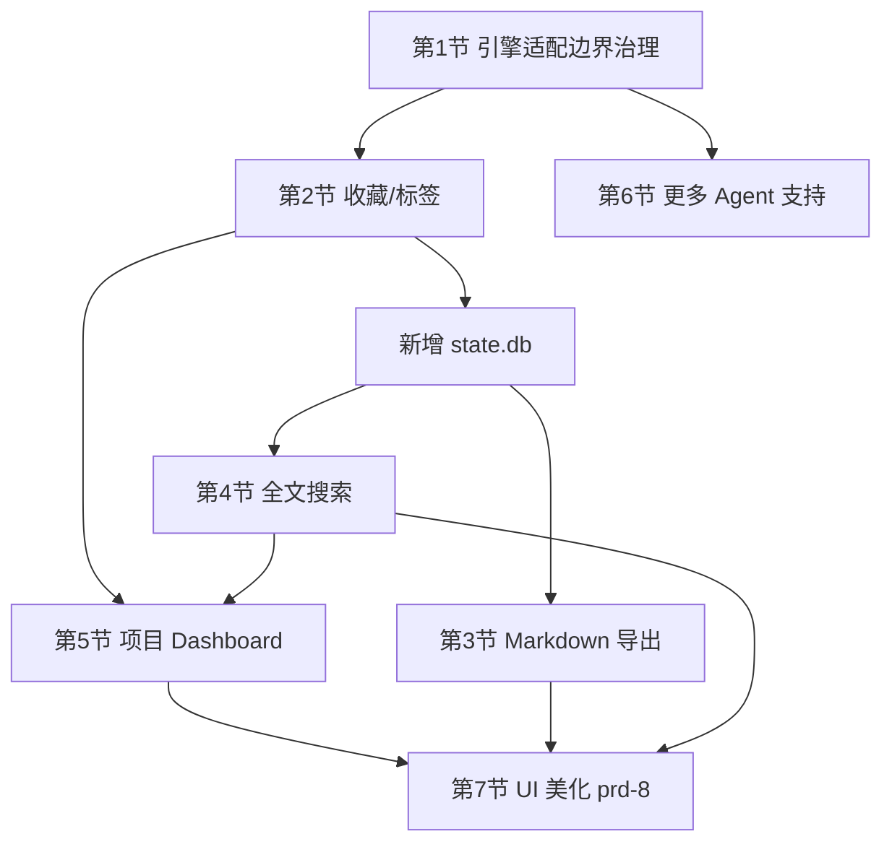

# 补充需求文档 (PRD-7) - 效率增强：标签、导出、全文搜索与项目 Dashboard

本文档承接 `prd.md` ~ `prd-6.md` 已交付的浏览 / 恢复 / 分组 / 多引擎能力，规划下一阶段的效率增强功能。

## 0. 范围与决策记录

### 0.1 本阶段功能清单（按实施顺序）

| 顺序 | 功能 | 类型 |
| :-- | :-- | :-- |
| 0 | 引擎适配边界治理（Plan A） | 工程护栏，非独立用户功能 |
| 1 | 收藏 / 标签 | 新功能 |
| 2 | Markdown 导出 | 新功能 |
| 3 | 全文搜索 | 新功能 |
| 4 | 项目 Dashboard | 新功能 |
| 5 | 更多 Agent 支持 | 新增引擎适配（示例/验证） |
| 6 | UI 美化 | 另出 `prd-8.md`，本文档只列收尾清单 |

### 0.2 已取消的功能（记录原因，避免后续误解为遗漏）

* **Git 关联**：已取消。原因：需求定义模糊（关联 branch？关联 commit 时间窗？），且与核心"回顾对话历史"场景耦合度不高，收益不确定，暂不投入。
* **Session Diff**：已取消。原因：通用会话间文本 diff 的语义对齐成本高、价值有限；即便收窄为"父子分支对比"仍属于探索性功能，本阶段优先做确定性更高的效率工具。

### 0.3 相对于初版讨论顺序的调整

* **Markdown 导出提前**：零依赖、可直接复用 `detail.rs` 已经产出的 `SessionDetail.transcript_blocks`，成本低、见效快，不应排在 Dashboard 之后。
* **"更多 Agent 支持"的工程底座（第 0 节）提前到全文搜索之前**：全文搜索、标签、Dashboard 都会新增跨引擎的数据处理逻辑，必须先钉死"引擎相关代码只能出现在哪些文件里"的规则，否则后续每新增一个引擎都要在 3-4 个新功能模块里重新分支一次。

---

## 1. 前提：引擎适配边界治理（Plan A 落地方案）

### 1.1 现状确认（基于当前代码）

项目已经存在一层**还不错的归一化基础**，不需要推倒重来：

* `catalog.rs`：`EngineCatalogReader::load_sessions_for` 按 `SessionEngine` match 分发到 `scan_pi_session_dir` / `scan_session_dir` / `scan_opencode_db` 等，产出统一的 `SessionListItem`。
* `detail.rs`：`load_detail_for_engine` / `SessionDetailLoader::load_viewport` 按引擎分发解析，但**输出已经是统一结构**：`SessionDetail { session_meta, transcript_blocks: Vec<TranscriptBlock> }`，`TranscriptBlock` 本身就是引擎无关的枚举（`UserText` / `AssistantMarkdown` / `Thinking` / `ToolCallSummary` / `ToolOutputSummary` / `SystemContextFolded` / `CorruptedLineNotice`）。
* `resume.rs`：已经是 trait + 依赖注入模式（`ResumeSessionExecutor`，每个引擎一个实现，由 `EngineAwareResumeExecutor` 按 `request.engine` 派发），是四个文件里抽象程度最高的。
* `delete.rs`：按 `SessionEngine` 做最简单的 match 分发。
* `SessionEngine` 已提供 `label()`、`root_dir()`、`opencode_db_path()` 等描述性方法，没有在 `app.rs` / `tui.rs` 里出现硬编码的引擎名字符串。

**结论**：不需要新造一套 `EngineAdapter trait` 体系。真正缺的是一条**治理规则**，防止新功能（标签/搜索/导出/Dashboard）在写的时候图方便又去 `match SessionEngine` 一次，导致新增引擎时要改 6-7 个地方而不是 4 个。

### 1.2 治理规则（写入 `.agent/AGENT.md` 或本文档，作为强制约束）

* **R1（适配层白名单）**：`catalog.rs`、`detail.rs`、`resume.rs`、`delete.rs` 是仅允许出现 `match engine` / `SessionEngine::Xxx` 分支判断的四个文件。
* **R2（消费归一化数据）**：本阶段新增模块（`tags.rs`、`search.rs`、`export.rs`、`dashboard.rs`，以及 `app.rs`/`tui.rs` 中的新增状态）只能消费 `SessionListItem` / `SessionDetail` / `TranscriptBlock` / `DetailViewport` 等已经引擎无关的数据结构，禁止对 `SessionEngine` 做业务分支。
* **R3（编译器兜底）**：新增引擎时只需要在 `SessionEngine` 枚举里加一个变体，Rust 的 match 穷尽性检查会在 R1 列出的四个文件里逐一报错，天然生成"需要改动的清单"，不需要额外维护一份人工登记表。
* **R4（能力差异走查询接口）**：若某新引擎有能力缺失（如不支持 resume、没有父子会话树），必须在 `SessionEngine` 上新增能力查询方法（如 `supports_resume(self) -> bool`），由调用方查询后降级处理，不允许在业务层写 `if engine == SessionEngine::Xxx`。

### 1.3 验收标准

* **AC1**：在测试代码中新增一个 mock/测试专用的 `SessionEngine` 变体后，编译错误只出现在 `catalog.rs` / `detail.rs` / `resume.rs` / `delete.rs` 四个文件内；`tags.rs` / `search.rs` / `export.rs` / `dashboard.rs` 无需修改即可通过编译。
* **AC2**：Code Review checklist 增加一条："本次 diff 是否在白名单外的文件引入了 `SessionEngine` 分支判断"。

> 第 5 节的"更多 Agent 支持"将复用本节规则作为验收标准，而不是重新设计一遍。

---

## 2. 收藏 / 标签

### 2.1 用户故事

作为长期使用者，我希望能标记重要会话（收藏）、给会话打自定义标签（如 `bug`、`需求梳理`、`重构`），以便日后按标签快速筛选，而不是依赖记忆去翻找。

### 2.2 数据存储方案

新增本工具**自有**的本地状态库，与只读的引擎数据（`~/.codex/sessions`、`opencode.db` 等）严格分离：

* 路径：`~/.session-manager/state.db`（SQLite，复用已有依赖 `rusqlite`）。
* 表结构：

```sql
CREATE TABLE session_meta (
    engine       TEXT    NOT NULL,   -- SessionEngine::label()
    session_id   TEXT    NOT NULL,
    is_favorite  INTEGER NOT NULL DEFAULT 0,
    tags         TEXT    NOT NULL DEFAULT '',  -- JSON 数组字符串，如 ["bug","refactor"]
    updated_at   INTEGER NOT NULL,
    PRIMARY KEY (engine, session_id)
);
```

* **身份键选择**：使用 `(engine, session_id)` 而非文件绝对路径。理由：路径可能因为文件整理、重命名而变化，`session_id` 是当前代码里各处（resume / delete / 树状父子关系解析）已经在使用的稳定标识。

### 2.3 加载与合并

* App 启动 / 手动刷新扫描完 `session_list` 后，一次性读取 `state.db` 全表到内存 `HashMap<(SessionEngine, String), SessionUserMeta>`，合并进每个 `SessionListItem`：新增 `is_favorite: bool`、`tags: Vec<String>` 字段。
* 写入是即时同步（收藏/改标签后立刻写 `state.db`），不做延迟批量写入，避免异常退出丢数据。

### 2.4 交互设计

* **快捷键**：
  * `f`：切换当前选中会话的收藏状态（列表焦点或详情焦点均可触发）。
  * `t`：打开标签编辑弹窗，复用 `DeleteModalState` 的弹窗交互模式（输入框 + 提交/取消焦点切换），输入逗号分隔标签，`Enter` 提交、`Esc` 取消。
* **列表视觉**：
  * 收藏会话在摘要前追加 `★`。
  * 有标签的会话在摘要后追加灰色小字 `#tag1 #tag2`（超宽时截断，遵循 prd-5 的截断规范）。
* **过滤复用现有搜索框**：不新增一套过滤 UI，在现有 `/` 输入解析里增加两个前缀语法：
  * `fav:` — 只显示收藏的会话。
  * `tag:关键字` — 只显示包含该标签（子串匹配）的会话。
  * 二者可与普通关键字组合，如 `tag:bug 登录`。
* **分组模式扩展**：复用 prd-5 定义的 `g` 循环切换分组模式，新增第三种：`By Time → By Project → By Tag → (循环)`。无标签的会话归入 `未分类` 分组。

### 2.5 验收标准

* **AC1**：Given 选中任意会话，When 按 `f`，Then 列表中该会话立即显示/取消 `★`，且重启程序后状态保持（读自 `state.db`）。
* **AC2**：Given 某会话打了标签 `bug`，When 在搜索框输入 `tag:bug`，Then 列表只保留包含该标签的会话，实时更新匹配数（复用现有 `live_search_matches` 机制）。
* **AC3**：Given `state.db` 不存在或损坏，When 程序启动，Then 静默视为"无收藏无标签"，不影响会话浏览主流程，不 panic。
* **AC4**：标签编辑弹窗遵循 R1/R2 规则，不引入按引擎的分支逻辑。

---

## 3. Markdown 导出

### 3.1 用户故事

作为使用者，我希望把某次对话导出为一份干净的 Markdown 文件，方便分享给同事、存档到笔记软件或粘贴进文档。

### 3.2 触发方式

* **单会话导出**：选中某个 session 叶子节点，按 `e`。
* **分组批量导出**：光标停在 Group Header（项目/时间/标签分组）时按 `e`，导出该分组下所有会话。

### 3.3 内容与映射规则

直接复用 `detail.rs` 的 `load_detail_for_engine` 输出（不重新解析 JSONL/SQLite），按 `TranscriptBlock` 类型映射：

| `TranscriptBlock` | Markdown 输出 |
| :-- | :-- |
| `UserText` | `### 🧑 User\n\n{text}\n` |
| `AssistantMarkdown` | `### 🤖 Assistant\n\n{text}\n`（原样保留，已是 Markdown） |
| `ToolCallSummary` / `ToolOutputSummary` | 按当前 `DisplayConfig.visible_blocks` 口径决定是否包含，默认与右侧详情面板当前显示的内容一致 |
| `Thinking` / `SystemContextFolded` / `CorruptedLineNotice` | 默认不导出（可通过导出弹窗勾选"包含完整上下文"覆盖） |

文件头部附加 YAML frontmatter：

```yaml
---
session_id: <session_id>
engine: <Codex|Claude|Pi|OpenCode>
cwd: <项目路径>
started_at: <会话开始时间>
exported_at: <导出时间>
favorite: <true|false>
tags: [bug, refactor]
---
```

### 3.4 导出路径与配置

* 默认导出目录：`~/.session-manager/exports/{engine}/{session_id}.md`。
* 分组批量导出：`~/.session-manager/exports/{engine}/{group_label}/`，并生成一份 `index.md` 汇总本次导出的文件列表。
* 支持在 `config.toml` 追加：

```toml
[export]
output_dir = "~/my-notes/ai-sessions"
```

* 导出完成后状态栏提示绝对路径；若目标文件已存在，直接覆盖（导出是确定性生成，不需要版本管理）。

### 3.5 验收标准

* **AC1**：Given 选中一个会话，When 按 `e`，Then 在配置的导出目录下生成对应 `.md` 文件，内容与右侧详情面板当前可见内容口径一致。
* **AC2**：Given 光标停在 Group Header，When 按 `e`，Then 该分组下所有会话被逐一导出，并生成 `index.md`。
* **AC3**：Given 会话内容包含损坏行（`CorruptedLineNotice`），When 导出，Then 不中断导出流程，该行按规则跳过或注明。
* **AC4**：导出逻辑只依赖 `SessionDetail` / `TranscriptBlock`，不直接读取引擎原始文件/数据库，遵循 R2。

---

## 4. 全文搜索

### 4.1 现状 vs 目标

* **现状**：`/` 搜索（`SearchState` / `searchable_text`）只匹配 `SessionListItem` 的元数据字段（session_id、name、summary、时间、cwd 等），**不涉及会话正文内容**，且只在当前已加载的列表内过滤。
* **目标**：支持跨全部已扫描会话、跨引擎的正文关键字检索，返回命中会话列表 + 命中片段（snippet），并可直接跳转到命中的具体消息位置。

这是本阶段工程量最大的功能，明确与现有元数据搜索（`/`）是两套并行能力，不合并、不互相影响现有行为。

### 4.2 技术方案

* **索引存储**：复用第 2 节新建的 `~/.session-manager/state.db`，新增 FTS5 虚拟表：

```sql
CREATE VIRTUAL TABLE session_content_fts USING fts5(
    engine,
    session_id,
    block_index,
    role,
    content,
    tokenize = 'unicode61'
);
```

* **Cargo 依赖调整**：`rusqlite` 需要额外启用 `fts5` feature：

```toml
rusqlite = { version = "0.32", features = ["bundled", "fts5"] }
```

* **索引构建时机与增量策略**：
  1. 每次 catalog 扫描（启动 / 手动刷新）得到 `SessionListItem` 列表后，比较每个会话源文件的 `mtime`/大小与 `state.db` 中记录的 `indexed_mtime`；发生变化才重新提取。
  2. 提取内容 = 调用 `detail.rs` 的 `load_detail_for_engine`，取 `transcript_blocks` 中 `UserText` / `AssistantMarkdown` / `ToolCallSummary` / `ToolOutputSummary` 四类文本写入 FTS 表（先按 `(engine, session_id)` 删除旧记录再插入，保证幂等）。
  3. 索引构建在后台线程执行，不阻塞 TUI 主循环；未完成时状态栏显示 `索引中 N/M`，允许用户照常浏览/搜索已完成部分。
  4. `Thinking` / `SystemContextFolded` / `CorruptedLineNotice` 默认不索引。

### 4.3 交互设计

* 新增全局快捷键 `Ctrl+F`（跨会话全文搜索），与现有 `/`（当前列表元数据过滤）明确区分，避免用户混淆两套搜索。
* 触发后弹出搜索输入浮层，输入时下方实时展示跨会话匹配结果（项目名 / 时间 / 命中片段高亮），方向键选择结果。
* `Enter` 跳转：切换到命中会话所在的 engine tab，选中该会话，并将详情视图定位到命中的具体 `transcript_block` 位置（需要在 `detail.rs` 补充一个"定位到第 N 个 block 附近视口"的 viewport API，参考现有 `TAIL_VIEWPORT_OFFSET` 的定位方式）。
* 索引未就绪或结果为空时给出明确文案，不留白屏。

### 4.4 验收标准

* **AC1**：Given 某会话正文中出现关键字（但摘要/文件名中没有），When 按 `Ctrl+F` 搜索该关键字，Then 该会话出现在结果列表中并显示命中片段。
* **AC2**：Given 一个 100MB+ 的会话文件正在被索引，When 用户在索引未完成前发起搜索，Then 已完成部分正常可搜，状态栏明确提示索引进度，不阻塞 UI 操作。
* **AC3**：Given 用户跳转到某条搜索结果，When 按 `Enter`，Then 详情面板正确切换 engine/session 并将视口滚动到命中内容附近。
* **AC4**：索引提取逻辑复用 `detail.rs` 现有解析函数，不新增一套按引擎分支的文本提取代码，遵循 R1/R2。
* **AC5**：`state.db` 可通过删除文件重建索引，不影响任何引擎自身的会话数据（只读性保证）。

---

## 5. 项目 Dashboard

### 5.1 定位

复用现有 `RightPanelMode` 枚举（当前含 `SessionDetail` / `GroupSummary`），新增 `RightPanelMode::ProjectDashboard`，作为"按项目分组"场景下的加强版统计视图。

### 5.2 触发方式

* 在"按项目分组"模式下，光标停在某个项目 Group Header 时按 `D`（大写），进入该项目的 Dashboard 详情视图。
* `Esc` / `q` 退出，返回原有的 `GroupSummary` 卡片视图。

### 5.3 展示指标（MVP 范围）

* 项目路径（`cwd_group_label`）。
* 总会话数，按引擎细分（如 `Codex: 12, Claude: 3`）。
* 收藏数（依赖第 2 节数据）。
* 标签分布 Top 5（依赖第 2 节数据）。
* 最近一次活跃时间。
* 若全文搜索索引已就绪（第 4 节）：该项目下的总消息数 / 估算总字数；索引未就绪时显示 `--`，不报错、不阻塞。

**明确不包含**：Git 提交信息（已取消需求）、时间趋势折线图等复杂可视化（TUI 下用 `ratatui` 的 `Sparkline`/`BarChart` 成本较高，MVP 阶段不做，如后续需要单独立项评估）。

### 5.4 交互

* Dashboard 内以列表形式展示"该项目下最近 N 条会话"，方向键选择、`Enter` 跳转到对应会话详情（复用现有 `begin_detail_request` 逻辑）。

### 5.5 验收标准

* **AC1**：Given 光标停在某项目 Group Header，When 按 `D`，Then 右侧面板切换为该项目的 Dashboard，展示 5.3 定义的指标。
* **AC2**：Given 全文搜索索引尚未就绪，When 打开 Dashboard，Then "总消息数/总字数"字段显示占位符而非报错或空白面板。
* **AC3**：Given Dashboard 内选中某条最近会话并按 `Enter`，Then 正确跳转到该会话的详情视图。
* **AC4**：Dashboard 的数据聚合逻辑只读取 `SessionListItem` 及第 2/4 节产出的用户数据，不新增按引擎分支代码。

---

## 6. 更多 Agent 支持

### 6.1 定位

本阶段不批量新增引擎，而是把第 1 节的治理规则作为**前提**，用一次真实的新引擎接入作为验收出口。

### 6.2 候选清单（待你确认优先级后再排期）

常见候选：Gemini CLI、Cursor CLI Agent、Aider、Cline / Roo Code、Amp、Continue 等。每个候选需要先确认：

* 会话数据落盘位置与格式（JSONL？SQLite？其它）。
* 是否有父子会话/子代理概念（类似 Codex 的 `parent_thread_id`、Pi 的子代理）。
* 是否有对应的 CLI resume 命令可供拉起。

> 这些信息需要你提供或后续单独调研，本文档不假设具体格式。

### 6.3 验收标准

* **AC1**：新增一个引擎，改动只发生在 `SessionEngine` 枚举 + 第 1.1 节列出的四个适配层文件（`catalog.rs` / `detail.rs` / `resume.rs` / `delete.rs`）。
* **AC2**：标签、导出、全文搜索、Dashboard 四个功能对新引擎自动生效，无需修改 `tags.rs` / `export.rs` / `search.rs` / `dashboard.rs`。
* **AC3**：若新引擎存在能力缺失（如不支持 resume），通过 `SessionEngine` 新增的能力查询方法降级处理，UI 给出明确提示（如按钮置灰或提示文案），不 panic。

---

## 7. UI 美化（收尾，另出 `prd-8.md`）

本阶段不展开具体视觉规范，待第 2-6 节功能落地、新增界面元素稳定后统一稽核，方法论沿用 `prd-6.md`（节点高亮规则、状态栏精简、帮助浮层模式）。已知需要在 `prd-8.md` 中覆盖的新增界面：

* 全文搜索浮层（`Ctrl+F`）。
* 标签编辑弹窗（`t`）。
* 收藏图标 / 标签徽标的配色与对齐。
* Dashboard 卡片布局。
* 导出成功/失败的状态栏提示样式。

---

## 8. 非目标（本阶段明确不做）

* Git 分支/commit 关联 —— 已取消。
* Session Diff / 分支对比 —— 已取消。
* 标签/收藏数据的云同步或多设备共享。
* 全文搜索的语义/向量检索（仅做关键字 FTS，不引入 embedding/模型依赖）。
* Dashboard 内的图表可视化（折线图/柱状图等）。

---

## 9. 里程碑依赖图



## 10. 风险与开放问题

* **`state.db` 与引擎自身数据隔离**：必须保证是完全独立的新文件，任何写操作都不落到 `~/.codex/sessions`、`opencode.db` 等引擎目录，维持工具对源数据的只读承诺。
* **首次建索引的性能与磁盘占用**：会话规模较大（数千个文件/GB 级）时，首次 FTS 索引构建耗时未知，需要实测；建议在 `config.toml` 提供 `[search] enabled = true/false` 开关，允许用户关闭。
* **标签编辑弹窗与现有 Modal 状态机的复用程度**：需要确认 `DeleteModalState` 的模式（输入 + 焦点切换）能否直接抽象出一个通用 Modal 结构，还是需要新增一套独立状态，实施时需先看 `app.rs` 现有 Modal 处理代码再决定。
* **全文搜索结果跳转到具体消息位置**：当前 `DetailViewport` 的定位能力是围绕 `offset`/`TAIL_VIEWPORT_OFFSET` 设计的，需要新增"定位到第 N 个 block"的能力，具体 API 形态需要在实施第 4 节时详细设计，本文档只定义需求，不锁定实现签名。
* **更多 Agent 支持的具体目标引擎**：候选清单未最终确认，需要你补充目标引擎的会话存储格式后才能真正排期实施（第 6 节目前只是治理规则的验收出口，不是本阶段的强制交付项）。
